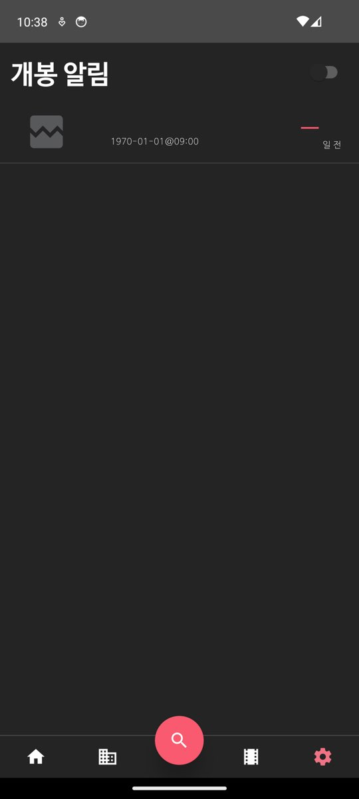

# Task #11 단계 보고서 — Gson non-null 필드의 지연 NPE

## 1. 결론

- `Movie` 생성자 인자 전부에 기본값을 주고 `@JsonAdapter(NullSkippingTypeAdapterFactory::class)` 를 붙였다. JSON 에 필드가 없거나 `null` 이어도 non-null 필드는 `""`·`emptyList()`·0·false 가 된다.
- 재현 테스트 2건이 수정 전 NPE 로 실패하고, 수정 후 4건 모두 통과했다.
- 에뮬레이터: `title: null` 인 영화가 든 알람을 SharedPreferences 에 넣고 설정 → 개봉 알림에 들어갔다. 수정 전에는 `ReleaseAlarmSettingsAdapter.java:51` 에서 FATAL NPE가 났고, 수정 후에는 FATAL 없이 목록이 표시된다.

## 2. 커밋 (브랜치 `task_11`, base `task_3`)

| 커밋 | 내용 |
|---|---|
| `1d726ad` test(android): #11 Movie 의 누락·null 필드가 사용 시점 NPE 를 내는 재현 테스트 | `schema/MovieGsonTest.kt` |
| `c1f8d16` fix(android): #11 Movie 의 누락·null 필드를 Kotlin 기본값으로 채운다 | `Movie.kt`, `NullSkippingTypeAdapterFactory.kt`, 테스트 1건 추가, 계획서 |
| (이 보고서와 같은 커밋) | 단계 보고서, 스크린샷 |

## 3. 재현 테스트 (수정 전, `1d726ad`)

```
./gradlew :app:testDebugUnitTest --console=plain
MovieGsonTest > explicit_nulls_get_non_null_defaults FAILED   (NullPointerException)
MovieGsonTest > missing_fields_get_non_null_defaults FAILED   (NullPointerException)
7 tests completed, 2 failed
```

에뮬레이터 재현 (수정 전 APK, `Pixel_API34`, 2026-11-09):

- `shared_prefs/alarmPref.xml` 의 `alarms` 에 `[{"movie":{"id":3,"title":null},"milliseconds":0,"pendingIntentID":1,"active":false}]` 를 넣었다 (`run-as` 복사).
- 설정 탭 → 개봉 알림 진입.

```
E AndroidRuntime: FATAL EXCEPTION: main
java.lang.NullPointerException: ... String.length() ...
    at com.lusle.android.soon.adapter.ReleaseAlarmSettingsAdapter.onBindViewHolder(ReleaseAlarmSettingsAdapter.java:51)
```


## 4. 변경

| 파일 | 변경 |
|---|---|
| `model/schema/Movie.kt` | 모든 인자에 기본값. 문자열 `""`, 목록 `emptyList()`, 수치 0, Boolean false, nullable 필드는 null. Kotlin 이 무인자 생성자를 만들어 Gson 이 `Unsafe` 대신 이를 쓴다 |
| `model/schema/NullSkippingTypeAdapterFactory.kt` (신규) | 읽기: `JsonElement` 로 받아 객체의 `JsonNull` 항목을 지운 뒤 `getDelegateAdapter` 의 `fromJsonTree` 로 넘긴다. 쓰기: 위임. 어노테이션 방식이라 Retrofit·SharedPreferences 의 모든 Gson 인스턴스에 적용된다 |
| `schema/MovieGsonTest.kt` | 누락 필드, 명시적 null, 값이 있는 필드, 저장된 `ArrayList<Alarm>` 왕복 — 4건 |

## 5. 검증

```
./gradlew :app:testDebugUnitTest :app:assembleDebug --console=plain     (2026-11-10)
BUILD SUCCESSFUL
ExceptionMessageTest 3/3, ExampleUnitTest 1/1, MovieGsonTest 4/4
```

에뮬레이터 (수정 후 APK, 2026-11-10 10:37, 같은 시드 데이터, `appops set … SCHEDULE_EXACT_ALARM allow`):

```
adb logcat -d | grep -c "FATAL EXCEPTION"    → 0
topResumedActivity = com.lusle.android.soon/.view.main.MainActivity
```

- 목록에 알람 1건이 표시된다. 제목은 빈 문자열, 포스터는 깨진 이미지 아이콘, 알람 시각 `1970-01-01@09:00`(시드 `milliseconds: 0`).
- `releaseDate` 가 `""` 라 같은 줄(`:51`)의 날짜 파싱이 `ParseException` 을 내고, 기존 catch 가 `SoonError` 로 기록한 뒤 D-day 를 `-` 로 표시한다. 이건 크래시가 아니라 설계된 처리 경로다.
- 같은 로그의 `ctbc … NullPointerException`(PID 4430)은 Google Play 서비스 프로세스 로그로, Soon 과 관계없다.



에뮬레이터는 공용 잠금(`~/.cache/herdr-sim.lock`)을 잡은 뒤 켰고, 확인 직후 `adb emu kill` 과 잠금 해제를 했다.

## 6. 범위 밖 · 후속

- 같은 패턴(기본값 없는 non-null 필드)이 남은 스키마: `MovieDetail`(14), `Cast`(10), `Crew`(9), `Backdrop`·`Poster`·`Video`(각 6), `WatchProvider`(4), `MovieResult`·`ProductionCompany`(각 3), `BelongsToCollection`·`Company`(각 2), `ProductionCountry`·`SpokenLanguage`·`WatchProviderResult`(각 1). 괄호 안은 `val x: Type,` 꼴 선언 수(grep 기준).
- `vote_average` 를 `Int` 로 선언해 생기는 `NumberFormatException` — 별도 이슈 필요.
- **새로 찾은 결함 (이슈 필요)**: `MainActivity.kt:167` 이 저장된 알람마다 `setExactAndAllowWhileIdle` 을 부르는데, `canScheduleExactAlarms()` 가 false 인 if/else 양쪽 모두에서 부른다. API 34 에서 저장된 알람이 하나라도 있으면 실행 시 `SecurityException: … needs to hold SCHEDULE_EXACT_ALARM …` 으로 종료된다. 이번 검증은 `appops` 로 권한을 허용해 우회했다.
